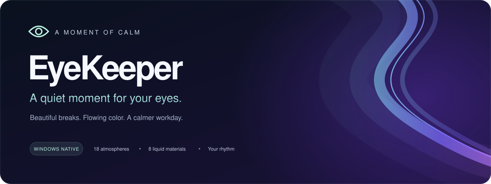
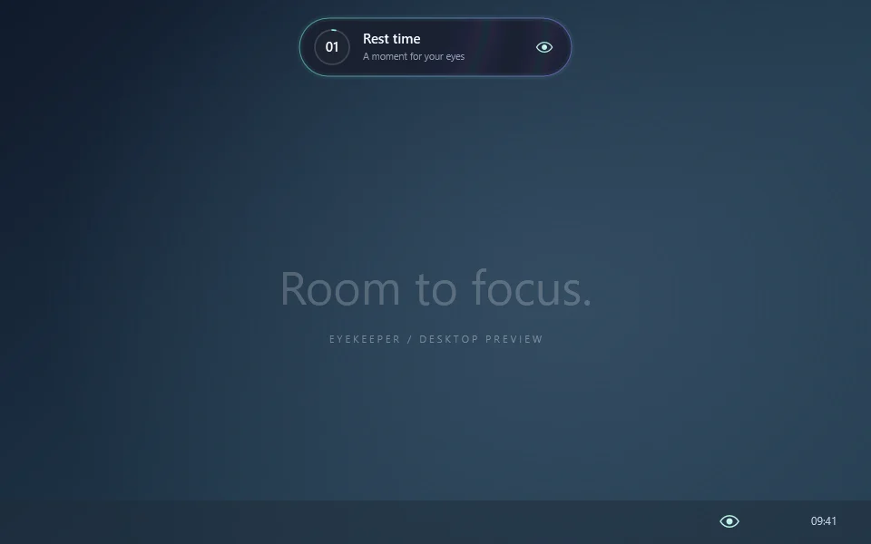
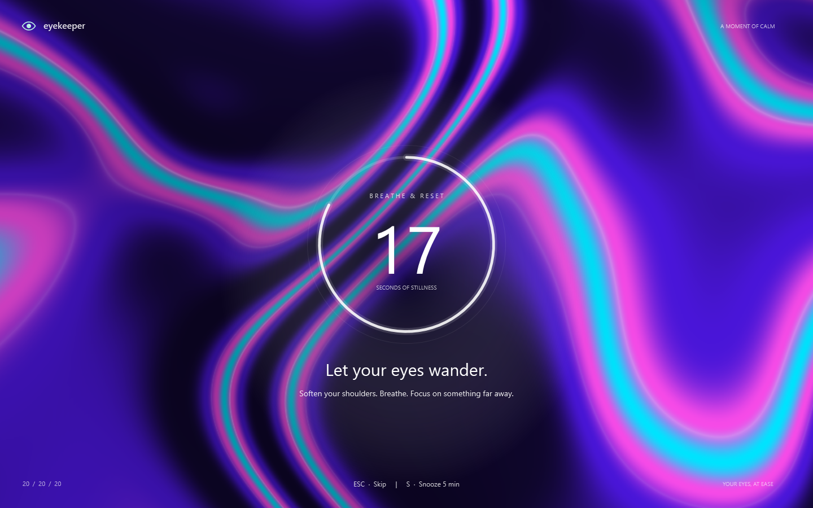
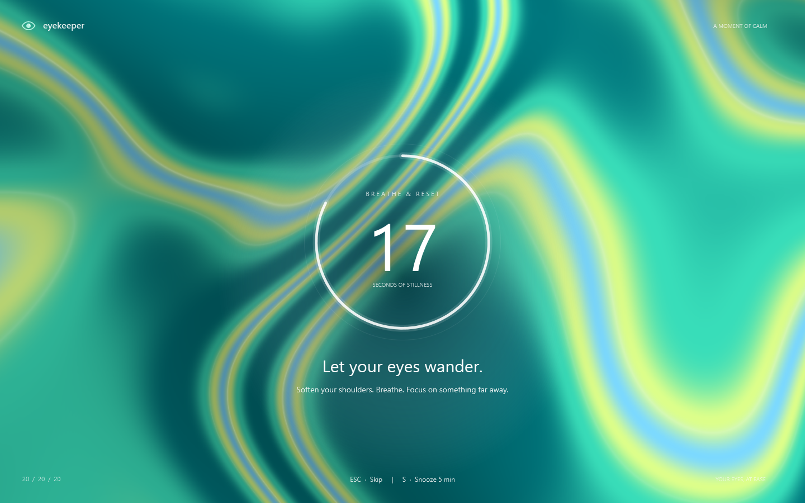
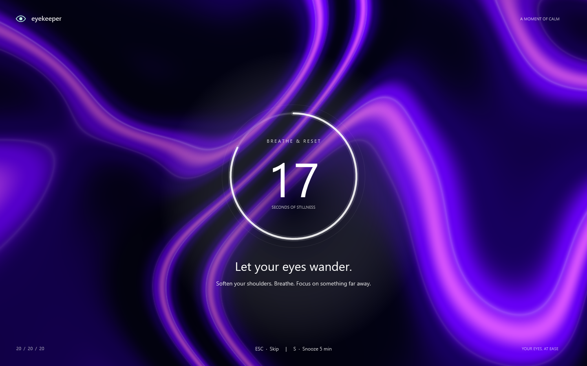
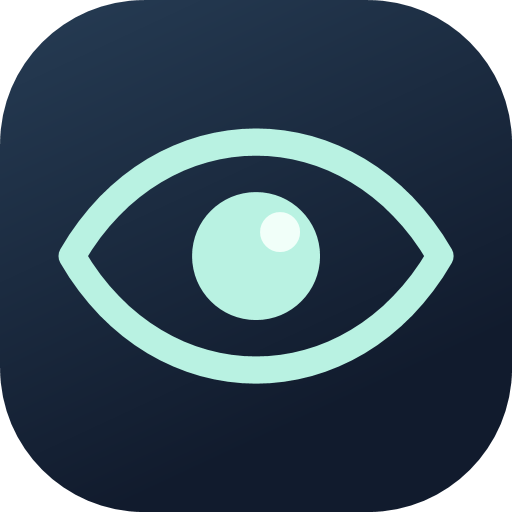

<div align="center">



<br>

[](https://github.com/Ali-zeiynali/EyeKeeper/actions/workflows/build.yml) [](https://github.com/Ali-zeiynali/EyeKeeper/releases/latest) [](https://github.com/Ali-zeiynali/EyeKeeper/releases)   

### Step away from the screen. Come back refreshed.

A quiet tray companion that turns your next eye break into flowing color, soft sound, and a moment to look into the distance.

**[Download for Windows](https://github.com/Ali-zeiynali/EyeKeeper/releases/latest)** &nbsp; · &nbsp; **[See it in motion](#a-small-reminder-a-beautiful-pause)** &nbsp; · &nbsp; **[Read the docs](docs/README.md)**

Native C# + WPF &nbsp; / &nbsp; No account &nbsp; / &nbsp; No browser runtime &nbsp; / &nbsp; No network requests from the app

</div>

---

## A small reminder. A beautiful pause.

EyeKeeper stays in your notification area while you work. A slim capsule gives you a **30-second heads-up**, then unfolds into an animated rest across your displays. When the countdown finishes, the color pours away and your desktop returns.

<p align="center">
  
</p>

<p align="center"><sub>Offscreen preview made with the app's controls and a CPU reference of its procedural materials. Multi-display previews use a simulated layout.</sub></p>

| Before the break | During the break | Back to work |
| :--- | :--- | :--- |
| A compact neon capsule, one gentle opening chime, and a silent warning countdown. | Liquid color, a bold countdown ring that pulses each second, and optional soft ticks. | A flowing downward exit, a completion cue, and the next work interval. |

<p align="center">
  
</p>

## Made to fit your rhythm

| | What you get |
| :--- | :--- |
| **🌊 Color that keeps moving** | 18 atmospheres × 8 procedural liquid materials. Pick your favorites or let each break choose a fresh combination. |
| **🖥️ Every screen, its own entrance** | Each monitor expands from its own center, with a coherent fluid material across the desktop and a liquid drain on exit. |
| **🔔 Sound with restraint** | One warning chime, soft rest ticks, and distinct start/finish cues. Mute everything, disable ticks, or adjust volume. |
| **◉ A little pulse, every second** | The countdown ring breathes with each new number. Ring pulse, background flow and liquid transitions have separate switches. |
| **🎛️ Your pace, your preferences** | Work/rest intervals, pause, snooze, immediate rest, and reduced motion in a small English tray panel. |
| **🛡️ Background recovery** | A separate guardian restarts unexpected worker exits. Setup adds a current-user recovery task; confirmed Quit stays respected. |
| **🔒 Local by design** | No account, screen capture, input tracking or telemetry. Settings and generated sounds stay on your machine. |

## Find your atmosphere

From luminous mint and pastel skies to midnight violet and warm ember. **Light, dark and vivid** palettes work with every motion style; random selection avoids an immediate repeat of the same palette or style.

<table>
  <tr>
    <td align="center"><a href="docs/previews/rest-aurora.png"></a><br><b>Aurora</b> · vivid</td>
    <td align="center"><a href="docs/previews/rest-mint.png"></a><br><b>Mint</b> · light</td>
    <td align="center"><a href="docs/previews/rest-midnight.png"></a><br><b>Midnight</b> · dark</td>
  </tr>
</table>

**Silk · Marble · Ribbons · Vortex · Bloom · Prism · Aurora · Contour**

[Explore all 18 palettes and 8 materials →](docs/GALLERY.md)

## Up and running in a minute

1. **[Open the latest release](https://github.com/Ali-zeiynali/EyeKeeper/releases/latest)** and download the Windows **Setup EXE**.
2. Run Setup for your Windows account. Choose whether to launch with Windows, then start EyeKeeper on the final page.
3. Click or right-click the eye icon in the notification area. If it is hidden, look under the tray overflow arrow.
4. Choose your rhythm, colors and sound, then select **Save preferences**.

The default is **20-minute work interval (heads-up in the final 30 seconds) → 20-second rest**. During rest, focus on something far away.

| Download | Best for |
| :--- | :--- |
| **Setup EXE — recommended** | Start menu shortcut, startup selection, guardian recovery task and Windows uninstall support. No administrator access needed. |
| **Self-contained ZIP** | Extracting to a permanent folder and running directly. No installer or scheduled recovery task; settings still use your Windows profile. |

**Windows 10 version 1809+ / Windows 11, x64.** The runtime is included. The current release is unsigned, so Windows may show an unknown-publisher or SmartScreen prompt. SHA-256 checksums are included with the downloads. Linux is not currently supported; Wine compatibility has not been verified.

[Installation, updates, checksums and uninstall →](docs/WINDOWS-RELEASE.md)

## Stay in control

| Action | Result |
| :--- | :--- |
| **Esc** during a warning or rest | Dismiss the reminder, even without overlay focus. The temporary hotkey is released afterward. |
| **S** while the rest window has focus | Snooze for five minutes. The on-screen snooze action also accepts a click. |
| **Pause 30 min / Resume** | Temporarily hold the schedule, then resume automatically or manually. |
| **Take a break** | Start a rest immediately. |
| **Close menu** | Hide preferences while reminders keep running. |
| **Application → Quit EyeKeeper completely…** | Confirm a full exit; the guardian and recovery task respect your choice. |

[Settings and everyday controls →](docs/USER-GUIDE.md)

## Native underneath, quiet in the background

EyeKeeper uses **C# / .NET 10 / WPF**, a native tray icon and separately compiled HLSL materials. Compatible systems render the fluid backgrounds on the GPU; a lower-resolution CPU fallback covers unsupported rendering environments. Continuous animation is detached after a break; the ordinary scheduler ticks four times per second.

The separate guardian can recover unexpected worker exits and detect a stalled UI heartbeat. Setup's current-user recovery task can restore a missing guardian. Intentional Quit, pause and startup preferences remain part of the design.

<details>
<summary><b>Build and test from source</b></summary>

On Windows with the .NET 10 SDK:

```powershell
git clone https://github.com/Ali-zeiynali/EyeKeeper.git
cd EyeKeeper
dotnet run --project tests/EyeKeeper.Tests -c Release
dotnet publish src/EyeKeeper/EyeKeeper.csproj -c Release -r win-x64 --self-contained true -p:PublishSingleFile=true -p:IncludeNativeLibrariesForSelfExtract=true -o artifacts/app
```

The commands above do not launch the tray app. For offscreen previews, shader builds, packaging and recovery integration tests, see the [development guide](docs/DEVELOPMENT.md).

</details>

## Documentation

| Start here | Go deeper |
| :--- | :--- |
| [Windows installation & release guide](docs/WINDOWS-RELEASE.md) | [Build, architecture & validation](docs/DEVELOPMENT.md) |
| [Settings & controls](docs/USER-GUIDE.md) | [Contributing](CONTRIBUTING.md) |
| [Visual gallery](docs/GALLERY.md) | [Changelog](CHANGELOG.md) |
| [Troubleshooting & FAQ](docs/TROUBLESHOOTING.md) | [Report a bug](https://github.com/Ali-zeiynali/EyeKeeper/issues/new) |

---

<div align="center">



**A moment of calm, between everything else.**

If EyeKeeper makes your workday a little better, consider [giving it a star](https://github.com/Ali-zeiynali/EyeKeeper). Feedback and thoughtful contributions are welcome.

</div>
