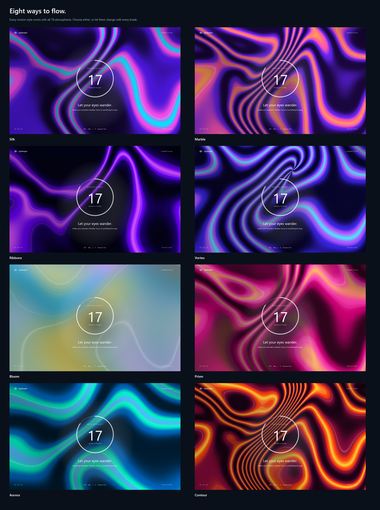

# EyeKeeper

A native Windows tray companion for eye-rest reminders, written in C# / .NET 10 / WPF. No browser runtime, Python runtime, account, network service, screen capture, or input tracking is used by the installed application.




## Use

The installer places the self-contained executable in `%LOCALAPPDATA%\Programs\EyeKeeper`, creates a Start menu shortcut and enables startup for the current user. Administrator permissions are not required.

Click or right-click its eye icon in the notification area to open preferences. Windows may put the icon under the tray overflow arrow. The app has no main window and normally runs quietly in the background.

- Default: work for 20 minutes, rest for 20 seconds; a 30-second capsule heads-up appears first.
- Each monitor unfolds from its own center. The fluid color material stays coherent across the desktop.
- Rest ends with the surface pouring down off each display.
- `Esc`: skip the current rest. `S`: snooze for five minutes. The footer also accepts a click on either action.
- Set work intervals, rest length, one of 18 atmospheres and one of 8 motion styles independently. Random selection avoids immediately repeating a color or motion style.
- Background flow, ring pulse and liquid transitions can each be disabled under **Animation details**. **Reduced motion** disables movement as a group.
- The ring pulses once at each countdown second, with the same clock driving the soft rest ticks. The warning capsule plays one opening chime and counts down silently; entering and completing a rest use distinct short cues.
- **Sound** has independent sound/tick toggles and volume. Tones are synthesized locally, preloaded and cached; playback does not change the system volume.
- **Save preferences** applies changes and starts a fresh work interval. **Pause 30 min** resumes automatically; **Resume** resumes early.
- **Close menu** only hides preferences; reminders keep running. Complete exit is under **Application → Quit EyeKeeper completely…** and requires confirmation. Opening and canceling that confirmation keeps the menu alive.
- **Launch with Windows** controls the current-user Run entry and whether the Windows recovery task may start the guardian automatically.

`Esc` is temporarily registered while an overlay is visible, so dismissing the reminder works even if the click-through window has not taken focus. The registration is released at dismissal; it is not held during ordinary work. Closing the menu and confirmed application exit remain separate actions.

Preferences are stored in `%LOCALAPPDATA%\EyeKeeper\settings.json`. Errors are recorded in `error.log` in the same folder. After a suspend/resume or unlocking the session, a running work schedule starts fresh so a stale break does not cover the desktop unexpectedly. A manual pause is retained.

Version 1.1 runs a separate guardian process. It restarts a worker that exits unexpectedly, with a bounded delay to avoid rapid crash loops. A shared-memory UI heartbeat detects a worker that has been unresponsive for 60 seconds. A suspend/resume gap is excluded from that timeout. The user-visible worker and the guardian each have a singleton mutex.

The current-user **EyeKeeper Recovery** Windows scheduled task checks once a minute and at login. It can restore a missing guardian and reattach an already-running worker. It runs without administrative privileges and respects an intentional confirmed Quit and the startup preference. A confirmed Quit writes an intentional-stop marker; starting EyeKeeper normally (or its login startup entry) resumes protection. `EyeKeeper.exe --stop` provides the same intentional shutdown for updating/uninstalling. Recovery is not a guarantee against every OS, hardware or application failure.

`lifecycle.log` records starts, recoveries and intentional exits. `worker.json` contains the worker PID and start timestamp used to validate a reattachment. No network monitor or remote service is involved.

## Build, test and install

Windows 10/11 x64 and the .NET 10 SDK are required to build. The published single-file app includes its runtime.

```powershell
powershell -ExecutionPolicy Bypass -File scripts/build.ps1
powershell -ExecutionPolicy Bypass -File scripts/install.ps1
```

`build.ps1` builds, renders previews without showing windows, runs the dependency-free test executable and publishes to `artifacts/app`. Python + Pillow are optional tooling for packaging animation frames into GIF/WebP; they are not used by the app.

For a one-off demonstration, first quit a running instance, then run `EyeKeeper.exe --demo`. It shows the full 30-second warning and a normal rest, then remains in the tray on the ordinary schedule. A second normal instance exits without changing the running process.

```powershell
dotnet run --project tests/EyeKeeper.Tests -c Release
dotnet src/EyeKeeper/bin/Release/net10.0-windows/EyeKeeper.dll --render-previews artifacts/previews
```

Render mode exits before creating a tray icon, acquiring the instance mutex, loading user settings or registering startup. `--diagnostics <file.json>` checks the WPF rendering tier, shader capability and shader loading without opening a window.

`--sound-lab <output-folder>` opens the optional developer sound preview. This window is only shown when explicitly requested; normal startup and background mode never open it. It uses temporary preferences and does not install a guardian or modify startup/settings. Optional preview-only builds can define `SOUND_LAB_BUILD`; the production build leaves that symbol undefined.

## Rendering

Eight procedural materials: Silk, Marble, Ribbons, Vortex, Bloom, Prism, Aurora and Contour. All work with all 18 palettes (144 combinations). The material evolves over time using nested domain warping; no downloaded wallpapers or videos are required.

The primary renderer uses WPF rendering tier 2 and Pixel Shader 3 when available, with eight separately compiled HLSL shaders and unused style branches removed for each material. The CPU reference renderer is used for offscreen previews and as a lower-resolution background-worker fallback where hardware rendering is unavailable, including remote sessions. The UI thread does not generate fallback animation frames. All continuous render handlers are detached after the rest and its exit animation; the normal background scheduler ticks four times per second.

The shader binaries are in `src/EyeKeeper/Assets/Fluid0.ps` through `Fluid7.ps`. Rebuild them after changing `Fluid.hlsl`:

```powershell
# Use fxc.exe from an installed Windows SDK.
fxc /T ps_3_0 /E main /O3 /D STYLE=0 /Fo src/EyeKeeper/Assets/Fluid0.ps src/EyeKeeper/Assets/Fluid.hlsl
# Repeat for STYLE=1 through STYLE=7 and matching output filenames.
```

Relevant primary references: [WPF hardware rendering](https://learn.microsoft.com/en-us/dotnet/desktop/wpf/advanced/optimizing-performance-taking-advantage-of-hardware), [ShaderEffect and PS 3 restrictions](https://learn.microsoft.com/en-us/dotnet/api/system.windows.media.effects.shadereffect), [WPF per-monitor DPI](https://github.com/microsoft/WPF-Samples/blob/main/PerMonitorDPI/readme.md).

## Saved previews and validation

[Neon reminder capsule](docs/previews/08-warning-capsule.png).

[All 18 palettes](docs/previews/05-palette-gallery.png). Individual full-size renders are saved as `docs/previews/rest-*.png`.

[All eight motion styles](docs/previews/07-motion-gallery.png). Individual full-size renders are saved as `docs/previews/motion-*.png`.

[Animated demo](docs/previews/06-liquid-demo.webp): the warning, unfolding, flowing background, pulsing ring and downward liquid exit. [Liquid exit still](docs/previews/09-liquid-exit.png).

These are offscreen renders of the same WPF controls and a CPU reference of the shader equations. The dual-display composition is a simulated layout, not a physical multi-monitor benchmark. Generated build output, machine diagnostics, installation receipts and runtime logs stay local under `artifacts/` and are excluded from Git.

The test executable covers scheduling, settings, procedural rendering, safe window closure and independent menu/exit actions. `scripts/test-recovery.ps1` is a separate integration test: it intentionally terminates the installed worker and guardian, verifies their recovery, verifies intentional shutdown, then resumes protection. Run it only when those interruptions are appropriate.
